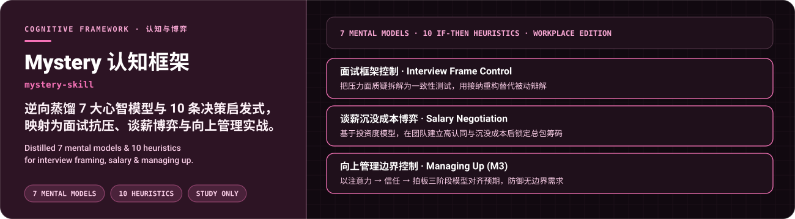
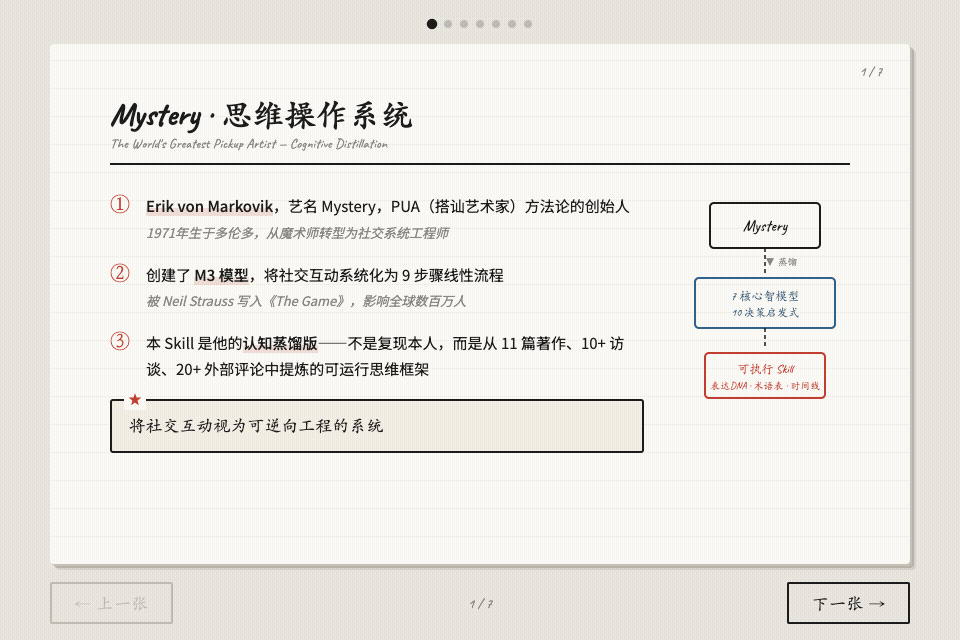
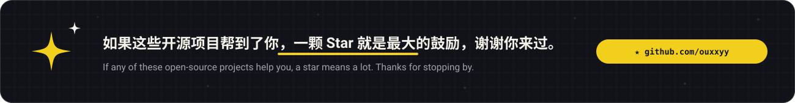

# Mystery 思维操作系统｜Mystery Method 认知框架与职场心理博弈 Skill

<!-- hero:start -->

<p>
  <a href="https://github.com/ouxxyy/ouba-classmate"></a>
</p>

**从公开著作与访谈中蒸馏 7 大心智模型与 10 条启发式规则，并映射为面试压力面拆解、谈薪防守与向上管理框架分析（供个人非商业学习）。**  
<sub>Public-source cognitive distillation of 7 mental models and 10 heuristics mapped to interview frame control & career study (non-commercial).</sub>

<p>
  <a href="https://github.com/ouxxyy/ouba-classmate"></a>
  <a href="#quick-example"></a>
  <a href="#quick-start"></a>
  <a href="#english-overview"></a>
  <a href="https://github.com/ouxxyy"></a>
</p>


<!-- hero:end -->

> **PUA 创始人 Mystery (Erik von Markovik) 的认知蒸馏 Skill + 职场框架控制实战包**
> 从 11 篇著作、10+ 访谈、20+ 外部评论中提炼的 7 个核心心智模型、10 条决策启发式、完整表达 DNA，并映射为**面试压力面拆解、谈薪底牌防守、向上管理边界控制**三套职场方案（见 [`workplace/`](workplace/)）。

---

## 🔥 职场场景专版（面试框架控制 · 谈薪博弈 · 向上管理）

面试、谈薪与跨部门博弈本质上是高信息不对称下的**框架争夺（Frame Control）**。想要完整求职工具链请访问 **[ouba-classmate 套件](https://github.com/ouxxyy/ouba-classmate)**，或直接进入本仓职场场景目录：

- **[面试框架控制 (`workplace/interview-frame-control.md`)](workplace/interview-frame-control.md)**：把压力面质疑作为“一致性测试（Congruence Test）”拆解，用“接纳并重构 + 故事嵌入式 DHV”替代被动辩解。
- **[谈薪博弈 (`workplace/salary-negotiation.md`)](workplace/salary-negotiation.md)**：基于投资度模型（Compliance / Investment），在用人部门建立沉没成本后再锁定总包筹码。
- **[向上管理 (`workplace/managing-up.md`)](workplace/managing-up.md)**：将 M3 阶段模型（注意力 → 信任 → 行动拍板）用于老板预期对齐与无边界需求防御。

> [!TIP]
> 🎁 扫码关注公众号「欧八同学」，免费领取 AI 案例与 Skill《大厂产品AI经验编程 200 套》→ [去扫码](#author)

[使用示例](#quick-example) · [开始使用](#quick-start) · [English](#english-overview)

<a id="quick-example"></a>

## 一次使用示例

**学习输入示例：**「比较 Mystery Method 中的框架概念与平等沟通：分别说明原始主张、局限，以及哪些建议不应直接照做。」

**输出：** 用公开资料整理的心智模型和决策启发式分析问题，同时保留伦理边界；不是官方认证建议，也不保证现实社交效果。

先看下方动画板书，再按 [使用说明](#quick-start) 加载 Skill。只用于个人学习研究，不可商用，也不能代替原著。

## 📺 动画板书预览



---

## 🧠 这是什么？

这不是一个角色扮演玩具。这是一个从 Mystery 公开文献中**逆向工程**出来的可运行认知框架。

| 传统角色扮演 | 认知蒸馏 Skill |
|:---:|:---:|
| 模拟人物口吻对话 | 提炼思维模型与决策逻辑 |
| 娱乐性强，实用性弱 | 结构化 If-Then 决策启发式 |
| 无法迁移到其他场景 | 可独立应用于社交分析 |
| 无边界约束 | 明确拒绝操纵性技术 |

---

## 🔑 7 个核心心智模型

| # | 模型 | 核心洞察 |
|---|------|---------|
| ① | **生存与繁殖价值论** | 生命终极目的是 S&R，所有社交都是价值判断循环 |
| ② | **吸引非选择论** | 吸引是进化机制，不能理性说服，只能触发电路 |
| ③ | **M3 模型系统化** | Attraction → Comfort → Seduction 九步骤线性流程 |
| ④ | **预选择杠杆** | 最强吸引开关是让别人（而非自己）证明你的价值 |
| ⑤ | **表演优于真实** | 构建高价值表演人格（Peacocking）胜过"做自己" |
| ⑥ | **框架拒绝策略** | "That's not in my reality"，不进入批评者框架 |
| ⑦ | **Cat String 推拉** | 像猫追绳子，保持可及性张力制造追逐动力 |

---

## 📐 M3 模型 · 9 步骤线性流程

```
🔥 A1: Open（开场）           3秒内行动，用预制材料
🔥 A2: Female-to-Male Interest 展示高价值 DHV，触发 IOI
🔥 A3: Male-to-Female Interest 收到 IOI 后才展示兴趣
🤝 C1: Conversation          建立基础对话舒适感
🤝 C2: Connection            发现共同价值观
🤝 C3: Intimacy              建立情感连接
💫 S1: Foreplay              递进肢体接触
💫 S2: Last Minute Resistance 处理 LMR
💫 S3: Sex                   完成
```

> ⚠ **跳阶段 = 失败**。必须按 A → C → S 顺序推进。

---

## 🗣 表达 DNA

Mystery 的语言有独特指纹：

- **工程语言描述社交** — circuitry, calibration, reverse-engineer
- **专属术语体系** — neg, DHV, IOI, peacocking, LMR, sarging
- **高度确定性** — 自称"world's greatest pickup artist"，极少"也许"
- **类比密度极高** — Cat String, Peacock, Video Game
- **先框架后结论** — 每个回答都先建立理论框架

> 读 100 字就能识别——这是 Mystery 的语言指纹。

---

## ✅ 使用场景 & ❌ 边界

| ✅ 可以做 | ❌ 拒绝做 |
|:---|:---|
| 社交冻结诊断与行动方案 | neg 侮辱 / 虚假贬低 |
| 价值展示指导（正向 DHV） | 欺骗性故事 / 情感操控 |
| 对话框架设计 | 利用对方脆弱制造依赖 |
| 渐进暴露练习计划 | 任何物化 / 人际剥削 |

> ⚠ 方法论局限提醒：表演人格无法承载真实需求。Mystery 自身崩溃已证明。

---

<a id="quick-start"></a>

## 🚀 如何使用

### 安装到你的 AI Agent

任何支持 `SKILL.md` 技能约定的 Agent 都能使用。以常见的用户级技能目录为例：

```bash
git clone https://github.com/ouxxyy/mystery-skill.git ~/.agents/skills/mystery-skill
```

`SKILL.md` 是入口，`references/research/` 下的调研文件会按需被 Agent 读取，不需要额外配置。

### 日常用法

1. **触发**：说「用 Mystery 视角」「Mystery 会怎么看」「社交动态分析」
2. **交互**：Skill 会以 Mystery 式分析框架直接回应，给出阶段判断和行动方案
3. **退出**：说「退出角色」「切回正常」

---

## 📁 文件结构

```
mystery-skill/
├── README.md                    # 本文件
├── mystery-board.gif            # 板书动图预览
├── qrcode.jpg                   # 公众号二维码
├── SKILL.md                     # Skill 主文件（19.8K）
└── references/
    └── research/
        ├── 01-writings.md       # 著作调研 (14.3K)
        ├── 02-conversations.md  # 访谈调研 (15.3K)
        ├── 03-expression-dna.md # 表达DNA (11.9K)
        ├── 04-external-views.md # 外部评论 (24.0K)
        ├── 05-decisions.md      # 决策记录 (17.0K)
        └── 06-timeline.md       # 时间线 (12.9K)
```

---

## 🏗 关于

- **创建工具**：女娲 · Skill 造人术（[huashu-nuwa](https://github.com/alchaincyf/huashu-skills)）
- **数据来源**：Mystery 公开发表的著作、访谈、媒体评论
- **内容边界**：本仓库是基于公开文献的整理与转述，仅供个人学习研究；Mystery 原著版权归原出版方所有，请勿将本仓库内容用于商业用途或当作原作替代品。

---

## 常见问题

### 这是 Mystery 官方发布或认证的 Skill 吗？

不是。它是基于公开材料整理的个人研究项目，不代表原作者或任何机构的认可。

### 可以用来学习欺骗、侮辱或操纵技巧吗？

项目明确拒绝侮辱、欺骗、情感操控和剥削，分析时保留对框架的批判和边界。

### 可以商用或保证社交结果吗？

只供个人学习研究，不可商用，也不能代替原著；没有现实行为改善的效果保证。

<a id="english-overview"></a>

## English overview

A public-source cognitive framework based on Mystery / Erik von Markovik, packaged as an Agent Skill for studying the Mystery Method, social analysis and decision heuristics.

See [usage](#quick-start). This is an independent study project, not an official or endorsed product. It is for personal, non-commercial study and does not replace the original works. Keep the explicit boundaries against deception, humiliation, manipulation and exploitation; no real-world outcome is guaranteed.

<!-- suite-matrix:start -->

## 更多开源项目 · More from ouba-classmate Suite

> 如果这个项目帮到了你，欢迎去旗舰合集仓 [**`ouxxyy/ouba-classmate`**](https://github.com/ouxxyy/ouba-classmate) 点一颗 Star 或一行安装全部 Skills：
> `npx skills add ouxxyy/ouba-classmate` · `gh api -X PUT /user/starred/ouxxyy/ouba-classmate`

| 仓库 · Repo | 分类 · Category | 它做什么 · What it does |
| --- | --- | --- |
| [`ouba-classmate`](https://github.com/ouxxyy/ouba-classmate) | SUITE · 旗舰合集 | **11 个原创项目总仓 + 一键安装全部 Skills + 在线战力测算与防身情报库**<br><sub>All-in-one Skills suite & benchmark</sub> |
| [`jd-resume-match`](https://github.com/ouxxyy/jd-resume-match) | CAREER · 求职涨薪 | **AI 简历优化与 JD 匹配体检（确定性公式 + 行号证据）**<br><sub>Deterministic JD matching & line-cited resume audit</sub> |
| [`ai-interviewer`](https://github.com/ouxxyy/ai-interviewer) | CAREER · 求职涨薪 | **中文语音/文字原话追问 AI 模拟面试官（含在线版）**<br><sub>Chinese voice AI mock interviewer anchored to your answers</sub> |
| [`job-search`](https://github.com/ouxxyy/job-search) | CAREER · 求职涨薪 | **跨 5 平台实时去重筛岗，输出带来源短名单**<br><sub>5-platform source-backed job search & shortlist builder</sub> |
| [`sherlock-company`](https://github.com/ouxxyy/sherlock-company) | CAREER · 求职涨薪 | **入职前四态证据公司背调与 Offer 核实清单**<br><sub>Pre-offer employer research with 4-state evidence boundaries</sub> |
| [`mbai`](https://github.com/ouxxyy/mbai) | CAREER · 求职涨薪 | **工作任务 AI 不可替代指数与 4 核决策复盘**<br><sub>Task-level AI irreplaceability index & decision reflection</sub> |
| [`codex-gif-video`](https://github.com/ouxxyy/codex-gif-video) | CREATIVE · AI 创作 | **69 种风格原生 GIF 与静音 MP4 素材生成 Skill**<br><sub>Native GPT Image 2.6 animated GIF & MP4 generator (69 styles)</sub> |
| [`storyboard-scavenger`](https://github.com/ouxxyy/storyboard-scavenger) | CREATIVE · AI 创作 | **可灵/即梦/Veo/Sora 七要素 AI 视频分镜工作流**<br><sub>7-element AI video storyboard skill for Kling & Seedance</sub> |
| [`travel-art-album-skill`](https://github.com/ouxxyy/travel-art-album-skill) | CREATIVE · AI 创作 | **旅行照片艺术画册与单文件离线翻页相册 Skill**<br><sub>Art-styled travel photo proofs & standalone offline HTML flipbook</sub> |
| [`mystery-skill`](https://github.com/ouxxyy/mystery-skill) · **Current** | COGNITION · 认知框架 | **Mystery 认知框架与职场心理博弈分析 Skill**<br><sub>Cognitive framework for interview frame & decision study</sub> |
| [`Attention`](https://github.com/ouxxyy/Attention) | LOCAL APP · 本地工具 | **ActivityWatch 本地专注力、心流时段与切换分析**<br><sub>Local ActivityWatch focus & context-switching dashboard</sub> |
| [`postapp`](https://github.com/ouxxyy/postapp) | LOCAL APP · 本地工具 | **Chrome 本地摄像头姿态检测与坐姿提醒插件**<br><sub>On-device MoveNet Chrome posture reminder extension</sub> |

<!-- suite-matrix:end -->

<a id="author"></a>

## 👤 作者

作者全平台同名：**欧八同学**。微信公众号扫码关注，免费领取 AI 案例与 Skill《大厂产品AI经验编程 200 套》。

- 个人主页 / 联系我：[albertou.redboook.cn](https://albertou.redboook.cn/)
- 抖音：[搜索“欧八同学”](https://www.douyin.com/search/%E6%AC%A7%E5%85%AB%E5%90%8C%E5%AD%A6)
- 小红书：[搜索“欧八同学”](https://www.xiaohongshu.com/search_result?keyword=%E6%AC%A7%E5%85%AB%E5%90%8C%E5%AD%A6)
- X：[搜索“欧八同学”](https://x.com/search?q=%E6%AC%A7%E5%85%AB%E5%90%8C%E5%AD%A6&src=typed_query)

<p align="center">
  
</p>

<p align="center"><sub>扫码关注「欧八同学」，免费领取《大厂产品AI经验编程 200 套》</sub></p>

如果这个 Skill 对你有启发，欢迎点个 Star。使用中遇到边界判断问题或框架失灵的场景，欢迎提 Issue 讨论。

---

*本 Skill 提供社交动态结构化分析方法论，明确拒绝操纵性技术与物化表达。*

<!-- footer:start -->

<p align="center">
  <a href="https://github.com/ouxxyy"></a>
</p>

<!-- footer:end -->
